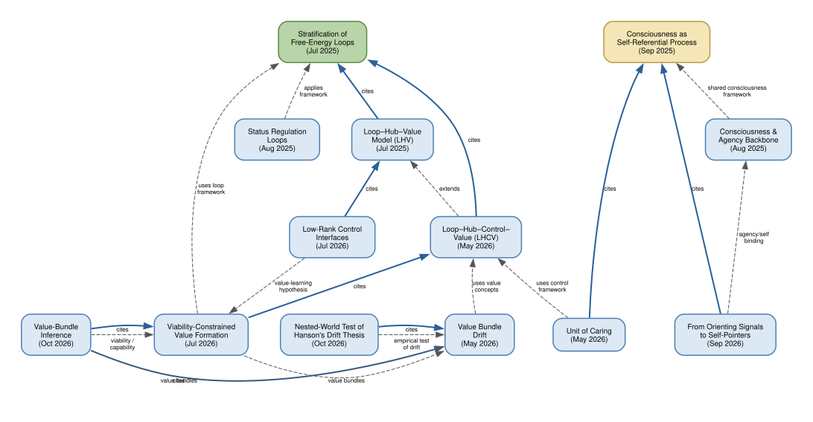

# Papers

LaTeX sources and built PDFs for each paper. Rebuild with the corresponding `build.sh` script.

## How the papers relate



Solid arrows are explicit `\cite` references (citer below, citee above); dashed arrows are conceptual dependencies or cross-repo links to [agency-detect](../../agency-detect/docs/papers/) (grey dashed nodes). Transitive edges are omitted.
The [DOT source](paper-references.dot) can be re-rendered with `dot -Tsvg papers/paper-references.dot -o papers/paper-references.svg`.

| Paper | Source | PDF | Build |
|-------|--------|-----|-------|
| Stratification of free-energy loops | [free_energy_loops.tex](free-energy-loops/free_energy_loops.tex) | [PDF](free-energy-loops/free_energy_loops.pdf) | `free-energy-loops/build.sh` |
| Loop–hub–value model (LHV) | [loop-hub-value-model.tex](loop-hub-value-model/loop-hub-value-model.tex) | [PDF](loop-hub-value-model/loop-hub-value-model.pdf) | `loop-hub-value-model/build.sh` |
| Status regulation loops | [status_regulation_as_free_energy_loops.tex](status-regulation-loops/status_regulation_as_free_energy_loops.tex) | [PDF](status-regulation-loops/status_regulation_as_free_energy_loops.pdf) | `status-regulation-loops/build.sh` |
| Consciousness and Agency on a Shared Neural Backbone | [consciousness_agency_backbone.tex](consciousness-agency-backbone/consciousness_agency_backbone.tex) | [PDF](consciousness-agency-backbone/consciousness_agency_backbone.pdf) | `consciousness-agency-backbone/build.sh` |
| Consciousness as a Self-Referential Physical Process | [consciousness-self-ref.tex](consciousness-self-ref/consciousness-self-ref.tex) | — | `consciousness-self-ref/build.sh` |
| Loop–hub–control–value (LHCV) | [lhcv-model-v2.tex](loop-hub-control-value/lhcv-model-v2.tex) | [PDF](loop-hub-control-value/lhcv-model-v2.pdf) | `loop-hub-control-value/build.sh` |
| LHCV reconstruction (control bypass, cultural reconstruction) | [lhcv-reconstruction.tex](lhcv-reconstruction/lhcv-reconstruction.tex) | [PDF](lhcv-reconstruction/lhcv-reconstruction.pdf) | `lhcv-reconstruction/build.sh` |
| Value bundle drift | [value-bundle-drift.tex](value-bundle-drift/value-bundle-drift.tex) | [PDF](value-bundle-drift/value-bundle-drift.pdf) | `value-bundle-drift/build.sh` |
| Nested-world test of Hanson's drift thesis | [on-hanson-values.tex](on-hanson-values/on-hanson-values.tex) | [PDF](on-hanson-values/on-hanson-values.pdf) | `on-hanson-values/build.sh` |
| Unit of caring | [unit-of-caring.tex](unit-of-caring/unit-of-caring.tex) | [PDF](unit-of-caring/unit-of-caring.pdf) | `unit-of-caring/build.sh` |
| Viability-constrained value formation | [embedded-value-formation.tex](embedded-value-formation/embedded-value-formation.tex) | [PDF](embedded-value-formation/embedded-value-formation.pdf) | `embedded-value-formation/build.sh` |
| From orienting signals to self-pointers | [self-pointers.tex](self-pointers/self-pointers.tex) | [PDF](self-pointers/self-pointers.pdf) | `self-pointers/build.sh` |
| Value-bundle inference | [value-bundle-inference.tex](value-bundle-inference/value-bundle-inference.tex) | [PDF](value-bundle-inference/value-bundle-inference.pdf) | `value-bundle-inference/build.sh` |

Build from the repo root:

```bash
papers/free-energy-loops/build.sh
papers/loop-hub-value-model/build.sh   # also regenerates the brain–value schematic
papers/status-regulation-loops/build.sh
papers/consciousness-agency-backbone/build.sh
papers/consciousness-self-ref/build.sh
papers/loop-hub-control-value/build.sh
papers/lhcv-reconstruction/build.sh   # pdflatex + bibtex + pdflatex ×2
papers/value-bundle-drift/build.sh
papers/on-hanson-values/build.sh   # figures from core_both/ and abc_extended_r3/, then pdflatex + bibtex + pdflatex ×2
papers/unit-of-caring/build.sh         # pdflatex + bibtex + pdflatex ×2
papers/embedded-value-formation/build.sh   # pdflatex + bibtex + pdflatex ×2
papers/self-pointers/build.sh   # pdflatex + bibtex + pdflatex ×2
papers/value-bundle-inference/build.sh   # pdflatex + bibtex + pdflatex ×2
```

LaTeX build artifacts (`*.aux`, `*.log`, etc.) are gitignored. Paper PDFs are tracked in git; regenerate after source changes.
